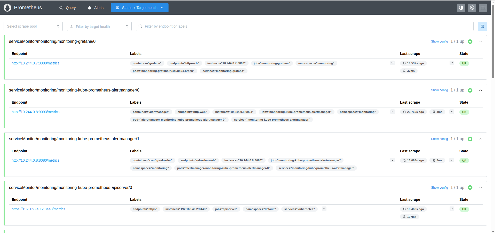
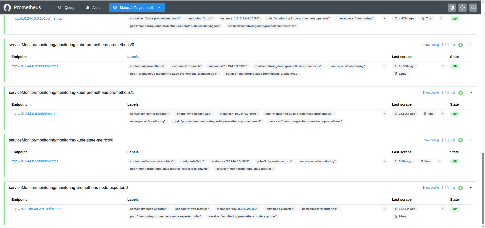
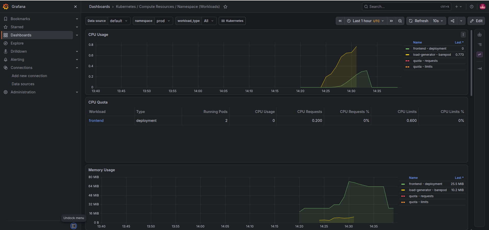
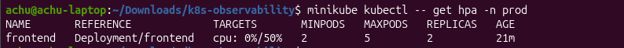

# Kubernetes Observability Lab

A hands-on Kubernetes project focused on cluster monitoring, metrics collection, Grafana dashboards, log aggregation configuration, and Horizontal Pod Autoscaling (HPA).

## Project Overview

This project uses a local **Minikube Kubernetes cluster** to practise Kubernetes observability and workload scaling.

The monitoring stack uses Prometheus and Grafana to collect and visualise Kubernetes metrics. Metrics Server provides resource metrics for workloads, while Horizontal Pod Autoscaling allows application replicas to scale based on resource utilisation.

The repository also contains Kubernetes manifests for an Elasticsearch, Fluentd, and Kibana (EFK) logging stack.

## Architecture

```text
                    Kubernetes Cluster
                         (Minikube)
                             |
             +---------------+---------------+
             |                               |
       Application Workloads             Monitoring
             |                               |
        Frontend / API                  Prometheus
             |                               |
       Horizontal Pod                    Grafana
       Autoscaler (HPA)                      |
             |                           Dashboards
       Replica Scaling

             Logging Configuration
                       |
                    Fluentd
                       |
                 Elasticsearch
                       |
                    Kibana
```

## Technology Stack

| Technology | Purpose |
|---|---|
| Kubernetes | Container orchestration |
| Minikube | Local Kubernetes environment |
| Docker | Container runtime |
| Helm | Monitoring stack deployment |
| Prometheus | Metrics collection |
| Grafana | Metrics visualisation |
| Metrics Server | Resource metrics for HPA |
| Fluentd | Log collection configuration |
| Elasticsearch | Log storage configuration |
| Kibana | Log visualisation configuration |
| YAML | Kubernetes configuration |
| Linux | Development environment |

## Validated Implementation

The following functionality was tested in a local Minikube environment:

| Component | Validation |
|---|---|
| Minikube cluster | Running single-node cluster |
| Prometheus | 14 active scrape targets shown as UP |
| Grafana | Kubernetes workload and resource dashboards viewed |
| Metrics Server | Resource metrics available |
| Frontend deployment | Nginx pods deployed in the `prod` namespace |
| HPA scale-up | Scaled from 2 to 3 and then 5 replicas during CPU load testing |
| HPA scale-down | Returned from 5 to 2 replicas after load was removed |

**Note:** These are local lab results, not production-cluster benchmarks.

## Project Screenshots

### Prometheus Targets

Prometheus scrape targets observed during local validation.





### Grafana Dashboard

Kubernetes workload resource usage, including CPU and memory metrics.



### Horizontal Pod Autoscaler

Frontend deployment autoscaler status after CPU load testing.



## Repository Structure

```text
k8s-observability/
│
├── efk/
│   ├── elasticsearch.yaml
│   ├── fluentd-configmap.yaml
│   ├── fluentd-daemonset.yaml
│   ├── fluentd-rbac.yaml
│   ├── kibana.yaml
│   └── logging-namespace.yaml
│
├── hpa/
│   └── hpa.yaml
│
├── prometheus/
│   ├── values.yaml
│   └── alertmanager-rules.yaml
│
├── scripts/
│
├── grafana-dashboard.png
├── hpa-status.png
├── prometheus-targets-1.png
├── prometheus-targets-2.png
└── README.md
```

## Local Environment

Tested environment:

- Ubuntu 26.04
- Minikube 1.39.0
- Kubernetes 1.37.0
- Docker 29.1.3
- Helm 4.3.1

## Deployment Guide

### 1. Start Minikube

```bash
minikube start --driver=docker
```

Check cluster status:

```bash
minikube status
kubectl get nodes
```

### 2. Enable Metrics Server

```bash
minikube addons enable metrics-server
```

Verify resource metrics:

```bash
kubectl top nodes
kubectl top pods -A
```

### 3. Create the monitoring namespace

```bash
kubectl create namespace monitoring
```

### 4. Configure Grafana credentials

The current `prometheus/values.yaml` contains a demonstration Grafana password:

```yaml
grafana:
  adminPassword: "changeme"
```

Change this value to a strong password before deploying the stack. Do not use demonstration credentials in a production environment or commit real passwords to a public repository.

The Alertmanager configuration also contains a placeholder Slack webhook URL. Replace it with a valid, securely managed webhook before expecting Slack notifications.

### 5. Add the Prometheus Community Helm repository

```bash
helm repo add prometheus-community https://prometheus-community.github.io/helm-charts
helm repo update
```

### 6. Install the monitoring stack

```bash
helm install monitoring prometheus-community/kube-prometheus-stack \
  --namespace monitoring \
  -f prometheus/values.yaml \
  --wait \
  --timeout 10m
```

### 7. Verify monitoring components

```bash
kubectl get pods -n monitoring
kubectl get services -n monitoring
```

Check Prometheus targets through the Prometheus web interface.

## Accessing Monitoring Dashboards

### Grafana

Start port forwarding:

```bash
kubectl port-forward -n monitoring svc/monitoring-grafana 3000:80
```

Open in your browser:

```text
http://localhost:3000
```

Use the Grafana administrator credentials configured in `prometheus/values.yaml`.

### Prometheus

Start port forwarding in another terminal:

```bash
kubectl port-forward -n monitoring svc/monitoring-kube-prometheus-prometheus 9090:9090
```

Open:

```text
http://localhost:9090
